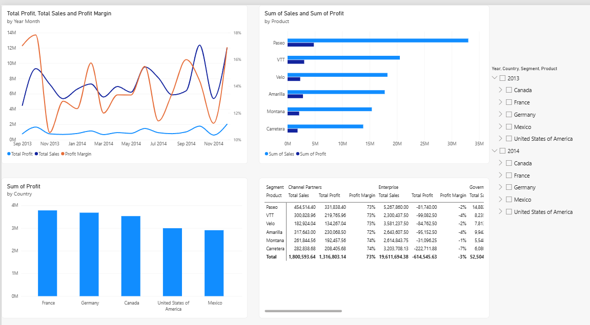

# financial-performance-analysis
Repository about analysis financial performance by dataset from Microsoft Power BI tool

# Financial Performance Analysis

## Dashboard Preview

## Business Objective

Analyze sales and profitability across products,
markets, and business segments.

## Tools Used

- Microsoft Power BI
- Power Query
- DAX

## Key Findings

- France is the most profit by Country
- Total Profit, Sales and Profit Margin by YearMonth (MMMM YYYY) shows the graph fluctuated significantly
- Profit slightly low showed in the graphics, impact from the lack of profit margin in Government part at Channel Partner

## Recommendations

- Add more meaningful insights not just seeing the full of graph, but also can be use the slicer for filter more various kind of data, for example by the Product Paseo, Country Canada, and the year of 2014

## Files

- Power BI Dashboard
- Screenshots Report
- Data Source
